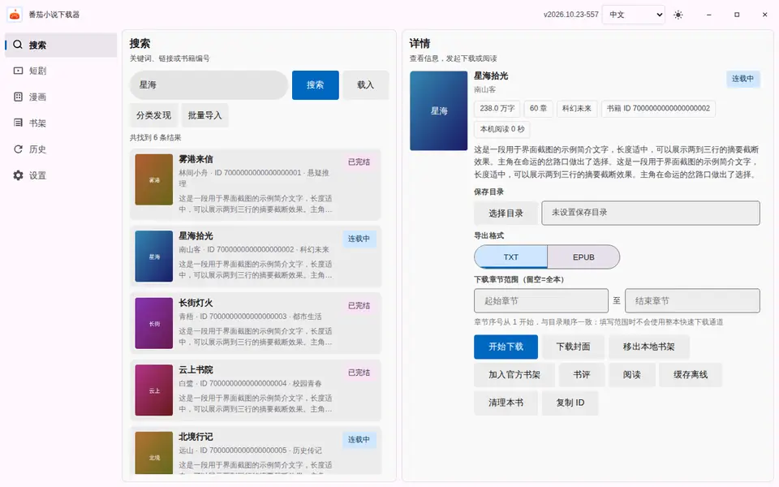
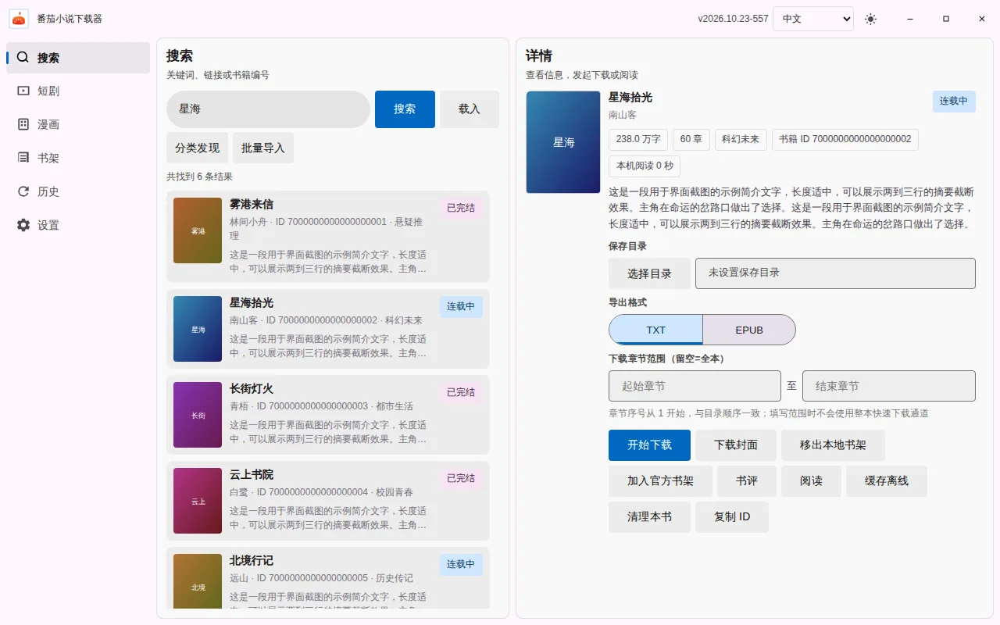
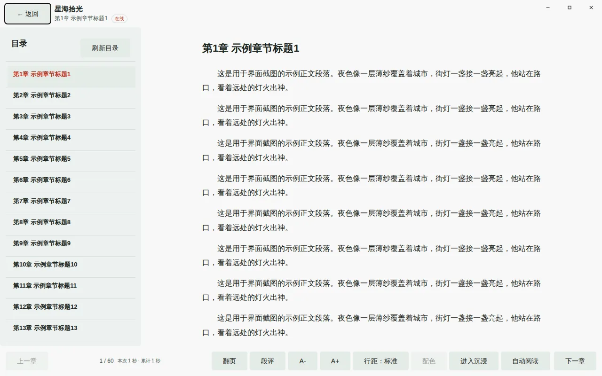
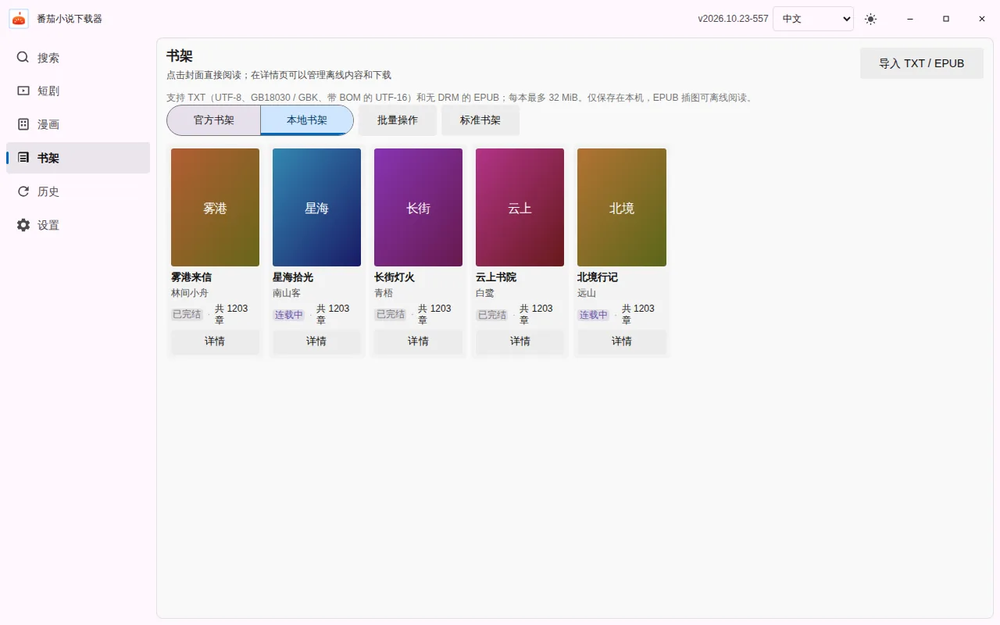
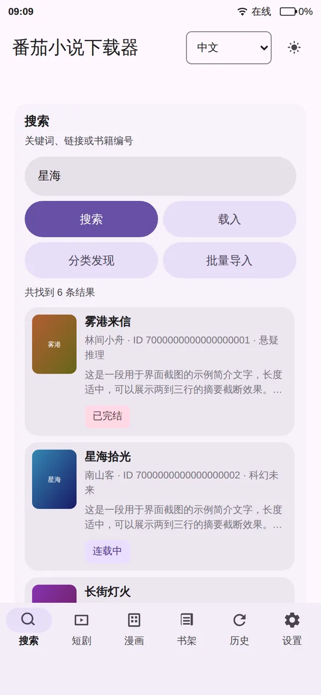

<div align="center">


# 番茄小说下载器

**小说、漫画、短剧，搜得到、存得下、读得爽。**

免费的番茄小说下载与阅读工具，Windows、macOS、Linux、Android、iOS 全平台可用。

[](https://github.com/POf-L/Fanqie-novel-Downloader/releases/latest)
[](https://github.com/POf-L/Fanqie-novel-Downloader/releases)
[](https://github.com/POf-L/Fanqie-novel-Downloader/stargazers)
[](https://github.com/POf-L/Fanqie-novel-Downloader/releases/latest)
[](#-下载安装)

<br>

[](https://github.com/POf-L/Fanqie-novel-Downloader/releases/latest)
[](https://github.com/POf-L/Fanqie-novel-Downloader/releases/latest)
[](https://github.com/POf-L/Fanqie-novel-Downloader/releases/latest)
[](https://github.com/POf-L/Fanqie-novel-Downloader/releases/latest)
[](https://github.com/POf-L/Fanqie-novel-Downloader/releases/latest)

[下载最新版](https://github.com/POf-L/Fanqie-novel-Downloader/releases/latest) ·
[安装说明](#-下载安装) ·
[常见问题](#-常见问题) ·
[反馈问题](https://github.com/POf-L/Fanqie-novel-Downloader/issues/new/choose) ·
[参与贡献](CONTRIBUTING.md)

</div>

<br>

<div align="center">

</div>

## ✨ 能做什么

<table>
<tr>
<td width="33%" valign="top">

### 🔍 搜书

输入书名、作者，或者直接粘贴番茄小说链接、书籍 ID 就能找到；结果里能看到分类、字数、评分和在读人数，改过名的书用原名也搜得到，书名和关键词一样的书排在最前面。搜索框会轮播大家都在搜的词。不知道看什么时，小说页有推荐，登录后按你的账号推荐；书籍详情底部有“相似书”。整份书单可以一次批量导入。

</td>
<td width="33%" valign="top">

### 📥 下载

导出 TXT / EPUB，可以只下指定章节；支持批量下载、暂停继续，书籍更新后一键重新下载。每本书可以单独起文件名，下载后也能重命名；简介不满意可以自己改，导出时就用你改的。还可以选择把热门段评一起导出（EPUB 里是段末脚注），能设最低点赞数和每段条数。下载出错后可以按设置自动重试，最后还是失败时弹系统通知。

</td>
<td width="33%" valign="top">

### 📖 阅读

翻页和滚动两种模式，多种阅读主题、沉浸模式、自动阅读；点击区域、翻页动效、底部信息栏都能自己调，还有 OLED 纯黑和墨水屏模式。可以看每段的段评，评论里的图片能点开放大。阅读器底栏有“书签”，没登录存在本机，登录番茄账号后和官方 App 的书签互通。底栏的“搜索”能在整本书里找字词；“本章热门”里有作者说、热门段落和热门划线。

</td>
</tr>
<tr>
<td valign="top">

### 📚 书架

本地书架加番茄官方书架，登录后自动同步，阅读进度也会同步到番茄账号；分组里可以按书名、最近阅读、更新时间等排序。不登录也有阅读历史：搜到就读、没下载没加书架的书，也能在“历史 → 阅读历史”里一点接着读。登录后点书架页的“官方记录”，能看你在官方 App 里的小说阅读历史、看过的短剧和追剧书架。

</td>
<td valign="top">

### 🎬 漫画和短剧

漫画在线看、下载章节图片，上下滚动时可以打开“跨话连续长条”，把两话图片接成一条一直往下滑，也可以设成滑到底自动进入下一话；单页模式可以像日漫那样从右往左翻，每一话都能看这一话的评论，详情底部有官方推荐的“看完还能看”；漫画和短剧都可以按官方分类浏览，短剧推荐页能一直“加载更多”；有原著小说的短剧可以“看原著”，或者从看到的那一集对应的章节接着读原著；阅读器里选中字词可以“查词”，看读音和释义；阅读器能下载番茄官方的在线字体；漫画可以按话下载成 CBZ；登录后书架页“官方记录”里能看到追更的书；短剧可以按关键词搜（走番茄搜索的短剧分页，不用登录），在线播放、下载视频（存成普通 MP4，常见播放器都能放），也能加进书架，登录后还能放进官方的追剧书架。未登录也能看到剧集列表，在线播放需要登录番茄账号。

</td>
<td valign="top">

### 📂 本地书

导入自己的 TXT / EPUB 直接读，文件只留在本机，不会上传。

</td>
</tr>
<tr>
<td valign="top">

### 🎨 个性化

经典、浅色、深色随心切换，可调强调色、界面密度和按钮大小；用不到的短剧、漫画、书架、历史入口可以从导航栏（手机上是底栏）隐藏；支持中文、English、Русский。

</td>
<td valign="top">

### 🔄 自动更新

电脑版在应用里就能下载安装新版本；手机版有新版本会提醒你。

</td>
<td valign="top">

### 🕶️ 隐私

阅读记录都存在本机；还能把应用伪装成计算器，输入密码才能打开。

</td>
</tr>
<tr>
<td valign="top">

### 🎧 听书

真人有声书、AI 音色和系统朗读都能听，边听边读，下次接着上次的位置；有声书也能下载到本地。Android 上还能用锁屏、通知栏和耳机按键控制。

</td>
<td valign="top">

### ☁️ 备份

书架、阅读进度、阅读历史和设置可以导出成备份文件，换设备后一键恢复；也可以连你自己的 WebDAV 服务器（坚果云、Nextcloud、群晖等）备份，可选自动备份，账号登录信息不会上传。

</td>
<td valign="top">

### 🖥️ 电脑版

关闭窗口可以最小化到系统托盘；按快捷键（默认 Ctrl+Alt+H，Mac 上是 Control+Option+H）一键隐藏或恢复窗口，Windows 还能设置成鼠标中键、侧键；再次打开程序会直接唤出已经在运行的窗口。

</td>
</tr>
</table>

## 📸 界面预览

<p align="center">
<picture>
  <source media="(prefers-color-scheme: dark)" srcset="docs/images/desktop-home-dark.webp">
  
</picture>
<br>
<sub>桌面版主界面：左侧导航，搜索结果和书籍详情左右并排（会跟着你的 GitHub 深浅色主题切换）</sub>
</p>

<table>
<tr>
<td width="50%" align="center"><br><sub>阅读器</sub></td>
<td width="50%" align="center"><br><sub>书架</sub></td>
</tr>
</table>

<table>
<tr>
<td width="33%" align="center"><br><sub>手机版：搜索</sub></td>
<td width="33%" align="center"><br><sub>手机版：书籍详情</sub></td>
<td width="33%" align="center"><br><sub>手机版：阅读</sub></td>
</tr>
</table>

<sub>截图使用虚构的示例书籍生成，以实际客户端为准。</sub>

## 📦 下载安装

所有安装包都在 **[Releases 最新版](https://github.com/POf-L/Fanqie-novel-Downloader/releases/latest)** 页面底部的 Assets 里，按下表挑一个就行。

| 平台 | 下载哪个文件 | 说明 |
| --- | --- | --- |
| 🪟 **Windows** | `windows-x64-setup.exe` | 安装版，推荐大多数人用 |
| | `windows-x64-portable.exe` | 免安装版，双击就能运行 |
| | 文件名里是 `arm64` 的 | Surface、骁龙等 ARM 电脑用 |
| 🍎 **macOS** | `darwin-aarch64.dmg` | Apple M 系列芯片 |
| | `darwin-x64.dmg` | Intel 芯片 |
| 🐧 **Linux** | `.deb` | Debian、Ubuntu 等 |
| | `.AppImage` | 其他发行版，免安装 |
| 🤖 **Android** | `android-arm64-v8a.apk` | 绝大多数手机选这个 |
| | `android-universal.apk` | 不确定手机型号时选这个，体积大一些 |
| 📱 **iOS** | `.ipa` | 需要自签安装，见下方说明 |

> [!TIP]
> Linux 和 Android 也分 x64 / ARM64，文件名里写着架构，选和设备一致的。Android 需要 7.0 及以上，iOS 需要 14 及以上。`.aab`、`.sig`、`latest.json` 和校验文件是给应用商店和自动更新用的，不用下载。

<details>
<summary><b>🪟 Windows：安装版还是免安装版？</b></summary>

<br>

- **安装版**（`setup.exe`）：会创建开始菜单快捷方式，可以在系统设置里卸载。
- **免安装版**（`portable.exe`）：放在哪儿都能直接打开，不写入系统，适合放 U 盘。

两种都能在应用里自动更新，而且各自更新成各自的版本，不会互相转换。首次运行如果被 SmartScreen 拦下，见[常见问题](#-常见问题)。

</details>

<details>
<summary><b>🍎 macOS：第一次打开被拦住怎么办？</b></summary>

<br>

安装包没有经过苹果公证，第一次打开时系统会拦一下，这是正常的：

1. 打开 DMG，把应用拖进“应用程序”文件夹。
2. 双击打开，看到提示后点“完成”。
3. 打开“系统设置 → 隐私与安全性”，在页面下方找到这个应用，点“仍要打开”，再确认一次。

以后就能正常打开了。如果提示“已损坏，无法打开”，见[常见问题](#-常见问题)。

</details>

<details>
<summary><b>🤖 Android：怎么安装？</b></summary>

<br>

用手机浏览器下载 APK，打开后按提示允许“安装未知应用”即可。升级时直接装新版覆盖，阅读记录和书架都会保留。

</details>

<details>
<summary><b>📱 iOS：怎么安装？</b></summary>

<br>

应用没有上架 App Store，需要用 [AltStore](https://altstore.io/)、[Sideloadly](https://sideloadly.io/) 或 TrollStore 等工具把 `.ipa` 装到手机上。装好后如果打不开，到“设置 → 通用 → VPN 与设备管理”里信任对应的证书。

</details>

<details>
<summary><b>🐧 Linux：AppImage 双击没反应？</b></summary>

<br>

先给它执行权限：

```bash
chmod +x FanqieNovelDownloader-*.AppImage
```

还打不开的话，用发行版自带的包管理器装上 WebKitGTK 4.1。

</details>

## ❓ 常见问题

<details>
<summary><b>新版已经发布了，应用里却提示“已是最新版”？</b></summary>

<br>

新版刚发布的一段时间里，GitHub 的 CDN 缓存还没刷新，老版本检查更新时会暂时拿到旧的版本信息，所以显示“已是最新版”。过一段时间再点一次“检查更新”就能识别到；新版应用遇到这种情况会说明更新包还在同步，可以稍后再检查，或者先手动下载。着急的话，直接到 [Releases 最新版](https://github.com/POf-L/Fanqie-novel-Downloader/releases/latest) 下载安装即可。

</details>

<details>
<summary><b>macOS 提示“已损坏，无法打开”或“无法验证开发者”？</b></summary>

<br>

文件并没有坏，是因为安装包没有苹果公证。先按上面的步骤到“系统设置 → 隐私与安全性”点“仍要打开”。如果还是提示已损坏，打开“终端”，输入下面这行后回车（应用放在其他位置的话，把路径换成实际位置），再重新打开：

```bash
xattr -dr com.apple.quarantine "/Applications/Fanqie Novel Downloader.app"
```

不需要关闭系统的 Gatekeeper。

</details>

<details>
<summary><b>Windows 弹出“Windows 已保护你的电脑”（SmartScreen）？</b></summary>

<br>

安装包没有购买微软的代码签名证书，所以会显示“未知发布者”。点 **“更多信息” → “仍要运行”** 即可。介意的话，可以先用 Release 里的 `SHA256SUMS` 文件核对一下下载的文件。

</details>

<details>
<summary><b>Windows 上双击图标没反应？</b></summary>

<br>

电脑版同一时间只运行一份：再次打开时，会直接唤出已经在运行的窗口（包括最小化到托盘、被快捷键隐藏的窗口），窗口跑到屏幕外时会移回来，不会再开一个。从 2026.11.4-1822 起，Windows 上如果已经在运行的那份卡住了、唤醒后不出窗口，或者是以管理员身份运行的，再双击会弹框说明情况，可以选“结束卡住的那一份，重新打开”；第一次打开超过 30 秒还没出窗口，也会弹框提示。旧版本双击没反应时，先试试按一下 Ctrl+Alt+H（窗口可能被快捷键隐藏了），再看右下角托盘里有没有应用图标；再打开任务管理器搜索 `Fanqie`，把残留的 `Fanqie Novel Downloader` 进程全部结束后重新打开。启动失败（比如 WebView2 缺失或损坏）时会弹出“番茄小说下载器无法启动”的提示框，按提示安装或修复 WebView2 运行时即可。还是不行的话，请[提交错误反馈](https://github.com/POf-L/Fanqie-novel-Downloader/issues/new?template=bug-report.yml)，写上完整版本号、Windows 版本，并附上日志文件夹 `%APPDATA%\com.pofl.fanqienoveldownloader\.log` 里最新的日志文件。

</details>

<details>
<summary><b>以前的免安装版怎么更新？</b></summary>

<br>

比较老的免安装版没法自动区分自己是哪个版本，需要手动更新一次：关掉程序，下载同架构的 `windows-*-portable.exe` 覆盖原文件。之后就会在原位置自动更新了。不要用 `setup.exe` 去覆盖免安装版。

</details>

<details>
<summary><b>Android 装新版时提示“与已安装的应用冲突”？</b></summary>

<br>

说明手机上的旧版和新版签名不一样（比如旧版是从别处下载的），需要先卸载旧版再安装。

</details>

<details>
<summary><b>下载的书保存在哪里？</b></summary>

<br>

在“设置 → 下载 → 保存与格式”里可以选择保存目录、TXT / EPUB 格式和导出文件名格式，改完自动保存；没选过目录时，电脑版第一次下载会先存到默认目录。下载前可以在下载表单里给这本书单独改文件名，下载后在“历史”里点“更多 → 重命名”。下载完成后，在“历史”里点对应的记录就能打开文件或所在文件夹。Android 上找不到文件时，在设置里重新选择一次保存目录并允许访问。

</details>

<details>
<summary><b>某个设置找不到？</b></summary>

<br>

从 2026.11.5-743 起，设置页顶部有搜索框：输入“段评”“日志”“长条”“阅读历史”这类词，点结果会直接跳到那一项并高亮。下载书籍时也能直接勾选“包含段评”“附带书评页”，和设置同步。升级后第一次打开会提示这个版本新加了什么、在哪里打开，每版只出现一次，可以选择以后不再提示。

</details>

<details>
<summary><b>段评能换成气泡图标、加分隔线，或者在 EPUB 里加书评页吗？</b></summary>

<br>

可以，从 2026.11.5-743 起都在“设置 → 下载 → 段评导出”，默认和以前一样：

- **段评标记**：可以从蓝色数字换成番茄风格的气泡图标，里面写这一段的实际段评数；图标（描边气泡、实心气泡、圆形、方形、自定义文字或图片）、颜色、数字放在图标里面还是外面、上下左右偏移都能调。
- **分隔线**：每条评论之间可以加细线、文字符号（比如“—”）或图片。
- **段评标题**：“段评3（原始段索引：7）”可以换成干净的“段评 3”，或者不显示。
- **EPUB 书评页**：书籍信息页末尾加一行“查看更多书评”，点进去是按热度排的书评。可以设总条数，再加任意多条关键词筛选，比如“一共 20 条，其中 3 条含‘避雷’”；没有符合的那条筛选会跳过。

</details>

<details>
<summary><b>墨水屏上怎么用更舒服？能用实体翻页键吗？</b></summary>

<br>

从 2026.11.5-743 起，打开“设置 → 外观 → 墨水屏界面优化”：界面只用纯黑和纯白，去掉阴影和动画，还可以选择文字加粗、边框加粗。阅读器里原来的“墨水屏显示模式”照旧可用。实体翻页键在阅读器里打开“阅读设置 → 屏幕与按键 → 自定义翻页按键”，点“添加按键”再按一下设备上的键，就能绑成上一页或下一页。这两项都只对当前设备生效，默认关闭。

</details>

<details>
<summary><b>Android 上顶部被状态栏挡住，或者底部和导航栏重叠？</b></summary>

<br>

先更新到 2026.11.5-1322 或更新的版本。从这一版起，应用会在 Android 原生层读取状态栏、挖孔和导航栏的实际高度，自动让开它们（#436），像荣耀 500（Android 17）这类 WebView 报不出安全区域的手机也不再被挡，一般不需要手动调任何设置。

个别机型更新后还是重叠的话，“设置 → 系统 → 任务与状态栏”里有“额外顶部留白”“额外底部留白”（从 2026.11.5-743 起），单位是像素，默认 0，调大到不再重叠为止；也可以试试同一处的“沉浸式全屏”和“始终隐藏状态栏”。如果还是不行，请提交错误反馈并附上诊断日志，日志里会完整记下各项布局尺寸，以及原生层和 WebView 各自报告的安全区域。

</details>

<details>
<summary><b>没登录，读过的书怎么找回来？</b></summary>

从 2026.11.5-449 起，在“历史”页上方切到“阅读历史”：读过的书都在这里（包括从搜索打开、没下载、没加书架的书），显示书名、作者、封面、读到哪一章和上次阅读时间，点一下从上次的位置接着读。每条可以单独删除，也可以清空，删掉的只是列表，阅读进度还在。阅读历史只存在本机，会跟着“备份与恢复”和 WebDAV 备份一起走；升级后第一次打开，之前读过的书会根据已有的阅读进度自动补进来。不想记录的话，在“设置 → 系统 → 阅读历史”里关掉“记录阅读历史”。

</details>

<details>
<summary><b>番茄短故事（短篇）的分享链接识别不了？</b></summary>

<br>

更新到 2026.11.6-514 或更新的版本（#438）。之后把 `https://changdunovel.com/t/…` 这类短故事分享链接粘贴到搜索框就能打开，也能放进批量下载；从番茄 App 复制的整段分享文案可以直接粘贴，不用自己把链接抠出来。

</details>

<details>
<summary><b>短剧搜什么都搜不出来？</b></summary>

2026.11.5-449 之前的版本，短剧的关键词只在首页那几部热门短剧的标题里找，所以大多数词都搜不到。从 2026.11.5-449 起改成走番茄搜索的短剧分页，不用登录，“总裁”“战神”“重生”这类词都能搜出一页结果，更新后再搜一次即可。还是搜不到时，多半是番茄那边临时限流，过一会儿再试；一直不行请提交错误反馈并附上诊断日志。

</details>

<details>
<summary><b>短剧只有声音、画面是黑的？</b></summary>

<br>

短剧是 HEVC（H.265）编码。电脑上没装“HEVC 视频扩展”时，应用会在播放 2 秒还没画面后自动切到兼容播放，不用改系统设置。只提供 BVC2 编码的剧集从 2026.11.6-514 起也能放了：BVC2 实际是 H.266（VVC），任何系统内核都解不了，应用会直接用内置的解码器走兼容播放（手机上第一次加载会慢一点）。2026.11.6-745 起兼容播放会按手机的 CPU 核数和内存同时开 1～4 路解码，卡顿会少很多。登录番茄账号后（2026.11.6-2116 起），短剧和漫画的进度会和官方番茄客户端互通：打开详情时取两边较新的那份，接着那一集、那一话看，看的时候进度也会同步回官方账号；没登录时进度只记在本应用里。下载下来的短剧是解密后的 MP4，可以用 VLC、PotPlayer 等播放器看。

</details>

<details>
<summary><b>换手机或电脑时，书架和进度怎么带过去？</b></summary>

<br>

在“设置 → 系统 → 备份与恢复”里点“导出备份”，到新设备上用“从文件恢复”导入即可。备份包括书架、阅读进度和时长、阅读历史、设置、划线和替换规则，不含账号登录信息、设备标识和保存目录，已经下载的 TXT / EPUB 文件需要自己拷过去。

也可以在同一处打开 WebDAV 云端备份（默认关闭），连上你自己的 WebDAV 服务器后手动备份，换设备时从云端恢复。自动备份和“上传下载好的 TXT / EPUB”都是可选项，默认不开；自动备份要在这台设备手动备份或恢复过一次之后才会生效，免得新设备的空数据盖掉云端那份。

</details>

<details>
<summary><b>书更新了，会自动重新下载吗？</b></summary>

<br>

不会自动下载。应用会定时检查已下载的书有没有新章节，你也可以在“历史”里手动点“检查书籍更新”，然后自己选择全部重下、只重下选中的，或者单本重下。新文件全部下载成功后才会替换旧文件。

</details>

<details>
<summary><b>搜索或下载一直超时？</b></summary>

<br>

先确认用的是最新版，再检查代理、DNS 或防火墙设置，过一会儿再试，不要短时间内反复重试。还是不行的话，按下面的方式提交反馈。

从 2026.11.5-1036 起，可以在“设置 → 下载 → 出错重试与通知”里设置“重试次数”（0–10，默认 0 不重试）和“重试间隔（秒）”（5–3600，默认 30），下载出错后会自动从断点重试；打开“下载失败时弹系统通知”后，最后一次也失败时会弹出写明书名和原因的系统通知（Windows、macOS、Linux）。

</details>

<details>
<summary><b>反馈问题时怎么导出诊断日志？</b></summary>

<br>

诊断日志始终开启，不用手动打开，也不能关闭；日志只保存在本机，账号、Cookie 和链接会自动脱敏。出问题之后打开“设置 → 系统 → 高级 → 诊断日志”（也可以在设置页顶部搜“日志”），点“导出诊断日志”；从 2026.11.5-743 起，出错提示条和失败的任务上也有“导出诊断日志”按钮。导出后会在下载目录生成一个 `fanqie-diagnostic-*.txt`，把它拖进 Issue 就行；“打开日志目录”可以直接看原始日志。

程序打不开时，直接上传日志文件夹里最新的 `.log` 文件：

- Windows：`%APPDATA%\com.pofl.fanqienoveldownloader\.log`（复制到资源管理器地址栏回车即可打开）
- macOS：`~/Library/Application Support/com.pofl.fanqienoveldownloader/.log`
- Linux：`~/.local/share/com.pofl.fanqienoveldownloader/.log`
- Android：系统“下载”目录下的 `.log` 文件夹（隐藏文件夹）

</details>

## 💬 反馈与交流

遇到问题或有想法，欢迎[提交 Issue](https://github.com/POf-L/Fanqie-novel-Downloader/issues/new/choose)，按情况选一个模板：

- 🐞 **错误反馈**：软件出错、闪退或功能不正常
- 💡 **功能建议**：希望新增或改进的功能
- 🙋 **使用求助**：安装、设置或使用上的问题

> [!IMPORTANT]
> **错误反馈必须附上诊断日志文件，没有日志的错误反馈不会处理。** 导出方法见上面的“[反馈问题时怎么导出诊断日志？](#-常见问题)”。没附日志的反馈会被自动打上“需要日志”标签，补上后标签会自动去掉。
>
> **错误反馈和使用求助**请先更新到最新版、搜一下有没有相同的 Issue，并填写完整版本号。
>
> **功能建议**请先读一下[产品边界](CONTRIBUTING.md#产品边界)，表里列出的方向不会做。

提交时请填写版本号和平台，并删掉截图、日志里的账号、Cookie 等个人信息。安全问题请走[私密报告](https://github.com/POf-L/Fanqie-novel-Downloader/security/advisories/new)，不要公开发 Issue。每个版本的更新内容见 [Releases](https://github.com/POf-L/Fanqie-novel-Downloader/releases)。

## ⭐ Star 趋势

觉得好用的话，点个 Star 支持一下吧！

<a href="https://star-history.com/#POf-L/Fanqie-novel-Downloader&Date">
 <picture>
   <source media="(prefers-color-scheme: dark)" srcset="https://api.star-history.com/svg?repos=pof-l/fanqie-novel-downloader&type=Date&theme=dark">
   
 </picture>
</a>

## ☕ 支持项目

如果这个项目对你有帮助，也欢迎自愿通过下面的合作服务支持项目维护：<https://999554.xyz/register?aff=Xf2p>

<sub>这是推广邀请链接，合作方标注通过该链接注册可获 1 美元，项目方也可能获得推广收益；用不用都不影响软件功能和问题处理。赞助与推广合作请通过[仓库所有者主页](https://github.com/POf-L)的联系方式沟通，不要提交为 Issue。</sub>

## 📜 免责声明

本工具免费提供，仅供个人学习和阅读使用，请支持正版。使用时请遵守相关平台规则和当地法律法规，不要用于高频批量下载、传播或其他侵犯作者与平台权益的用途。项目不保证上游接口一直可用，因使用本工具产生的后果由使用者自行承担。

---

<div align="center">

**遇到问题或有想法？**

[🐞 报告错误](https://github.com/POf-L/Fanqie-novel-Downloader/issues/new?template=bug-report.yml) ·
[💡 功能建议](https://github.com/POf-L/Fanqie-novel-Downloader/issues/new?template=feature-request.yml) ·
[🙋 使用求助](https://github.com/POf-L/Fanqie-novel-Downloader/issues/new?template=help-request.yml) ·
[🤝 参与贡献与产品边界](CONTRIBUTING.md) ·
[🔒 私密报告安全问题](https://github.com/POf-L/Fanqie-novel-Downloader/security/advisories/new)

</div>
