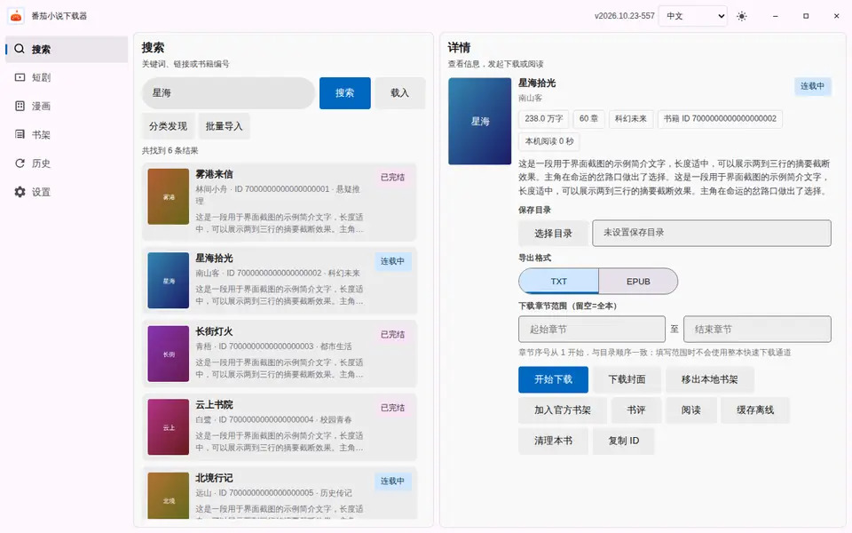
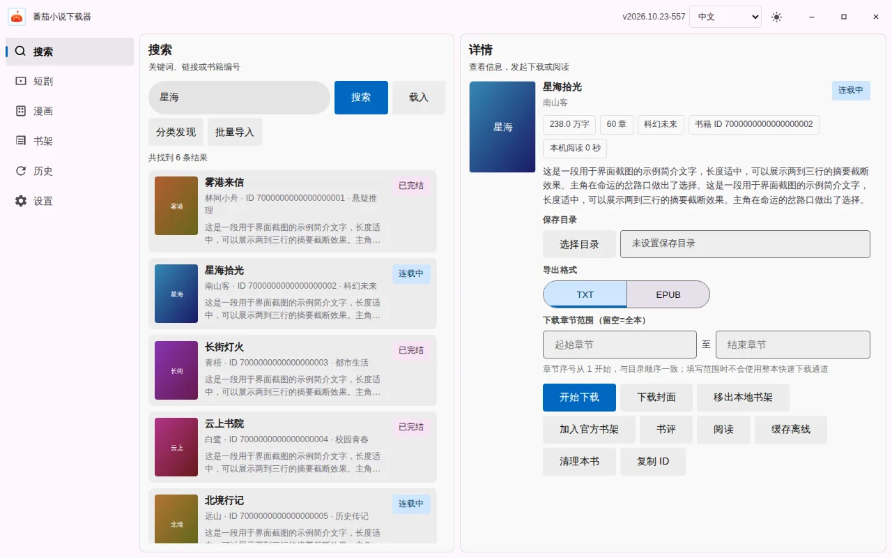
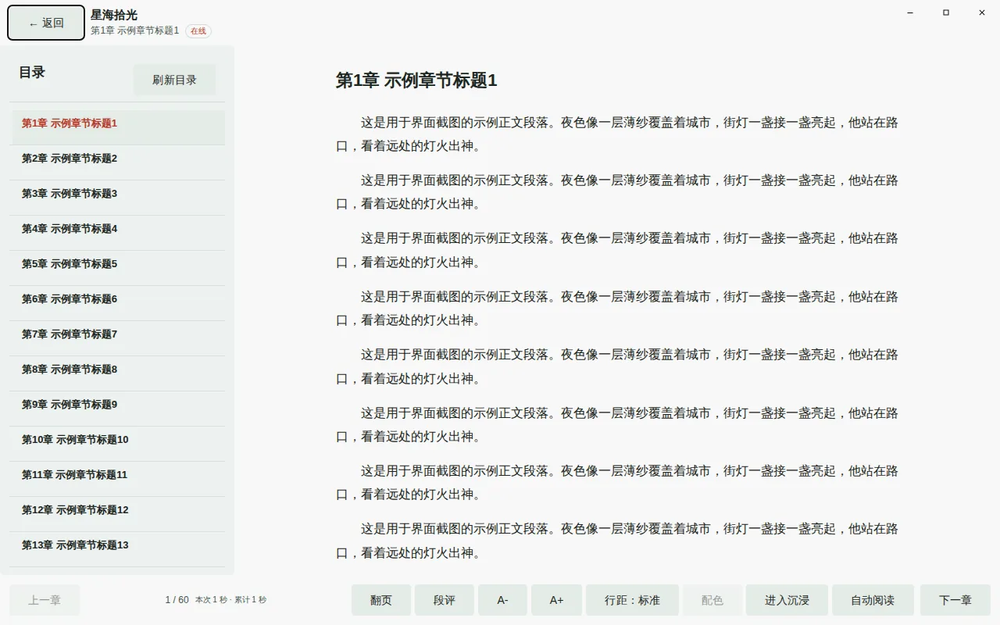
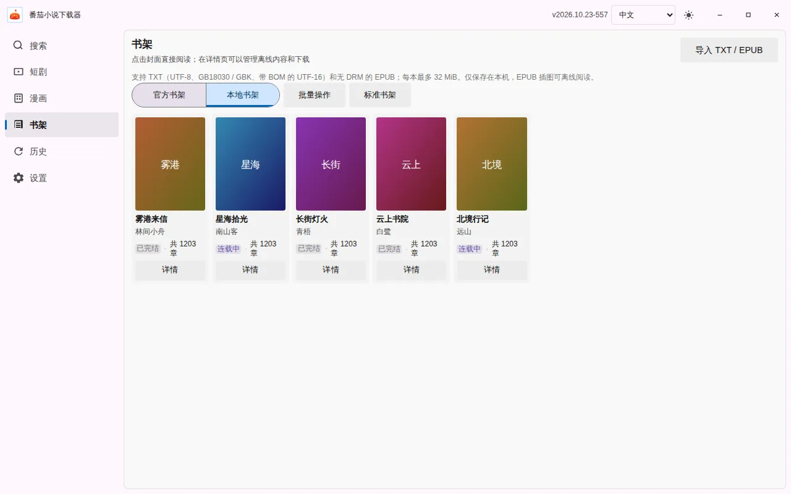
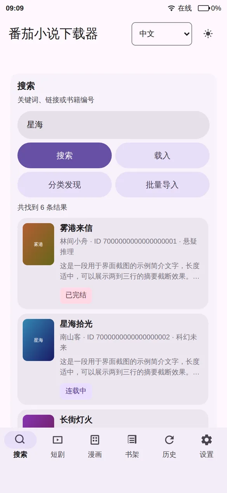

<div align="center">


# 番茄小说下载器

**小说、漫画、短剧，搜得到、存得下、读得爽。**

免费的番茄小说下载与阅读工具，Windows、macOS、Linux、Android、iOS 全平台可用。

[](https://github.com/POf-L/Fanqie-novel-Downloader/releases/latest)
[](https://github.com/POf-L/Fanqie-novel-Downloader/releases)
[](https://github.com/POf-L/Fanqie-novel-Downloader/stargazers)
[](https://github.com/POf-L/Fanqie-novel-Downloader/releases/latest)
[](#-下载安装)

<br>

[](https://github.com/POf-L/Fanqie-novel-Downloader/releases/latest)
[](https://github.com/POf-L/Fanqie-novel-Downloader/releases/latest)
[](https://github.com/POf-L/Fanqie-novel-Downloader/releases/latest)
[](https://github.com/POf-L/Fanqie-novel-Downloader/releases/latest)
[](https://github.com/POf-L/Fanqie-novel-Downloader/releases/latest)

[下载最新版](https://github.com/POf-L/Fanqie-novel-Downloader/releases/latest) ·
[安装说明](#-下载安装) ·
[常见问题](#-常见问题) ·
[反馈问题](https://github.com/POf-L/Fanqie-novel-Downloader/issues/new/choose) ·
[参与贡献](CONTRIBUTING.md)

</div>

<br>

<div align="center">

</div>

## ✨ 能做什么

<table>
<tr>
<td width="33%" valign="top">

### 🔍 搜书

输入书名、作者，或者直接粘贴番茄小说链接、书籍 ID 就能找到；整份书单可以一次批量导入。

</td>
<td width="33%" valign="top">

### 📥 下载

导出 TXT / EPUB，可以只下指定章节；支持批量下载、暂停继续，书籍更新后一键重新下载。

</td>
<td width="33%" valign="top">

### 📖 阅读

翻页和滚动两种模式，多种阅读主题、沉浸模式、自动阅读，还能看每段的段评。

</td>
</tr>
<tr>
<td valign="top">

### 📚 书架

本地书架加番茄官方书架，登录后自动同步；分组里可以按书名、最近阅读、更新时间等排序。

</td>
<td valign="top">

### 🎬 漫画和短剧

漫画在线看、下载章节图片；短剧在线播放、下载视频，也能加进书架。

</td>
<td valign="top">

### 📂 本地书

导入自己的 TXT / EPUB 直接读，文件只留在本机，不会上传。

</td>
</tr>
<tr>
<td valign="top">

### 🎨 个性化

浅色、深色随心切换，可调强调色、界面密度和按钮大小；支持中文、English、Русский。

</td>
<td valign="top">

### 🔄 自动更新

电脑版在应用里就能下载安装新版本；手机版有新版本会提醒你。

</td>
<td valign="top">

### 🕶️ 隐私

阅读记录都存在本机；还能把应用伪装成计算器，输入密码才能打开。

</td>
</tr>
</table>

## 📸 界面预览

<p align="center">
<picture>
  <source media="(prefers-color-scheme: dark)" srcset="docs/images/desktop-home-dark.webp">
  
</picture>
<br>
<sub>桌面版主界面：左侧导航，搜索结果和书籍详情左右并排（会跟着你的 GitHub 深浅色主题切换）</sub>
</p>

<table>
<tr>
<td width="50%" align="center"><br><sub>阅读器</sub></td>
<td width="50%" align="center"><br><sub>书架</sub></td>
</tr>
</table>

<table>
<tr>
<td width="33%" align="center"><br><sub>手机版：搜索</sub></td>
<td width="33%" align="center"><br><sub>手机版：书籍详情</sub></td>
<td width="33%" align="center"><br><sub>手机版：阅读</sub></td>
</tr>
</table>

<sub>截图使用虚构的示例书籍生成，以实际客户端为准。</sub>

## 📦 下载安装

所有安装包都在 **[Releases 最新版](https://github.com/POf-L/Fanqie-novel-Downloader/releases/latest)** 页面底部的 Assets 里，按下表挑一个就行。

| 平台 | 下载哪个文件 | 说明 |
| --- | --- | --- |
| 🪟 **Windows** | `windows-x64-setup.exe` | 安装版，推荐大多数人用 |
| | `windows-x64-portable.exe` | 免安装版，双击就能运行 |
| | 文件名里是 `arm64` 的 | Surface、骁龙等 ARM 电脑用 |
| 🍎 **macOS** | `darwin-aarch64.dmg` | Apple M 系列芯片 |
| | `darwin-x64.dmg` | Intel 芯片 |
| 🐧 **Linux** | `.deb` | Debian、Ubuntu 等 |
| | `.AppImage` | 其他发行版，免安装 |
| 🤖 **Android** | `android-arm64-v8a.apk` | 绝大多数手机选这个 |
| | `android-universal.apk` | 不确定手机型号时选这个，体积大一些 |
| 📱 **iOS** | `.ipa` | 需要自签安装，见下方说明 |

> [!TIP]
> Linux 和 Android 也分 x64 / ARM64，文件名里写着架构，选和设备一致的。Android 需要 7.0 及以上，iOS 需要 14 及以上。`.aab`、`.sig`、`latest.json` 和校验文件是给应用商店和自动更新用的，不用下载。

<details>
<summary><b>🪟 Windows：安装版还是免安装版？</b></summary>

<br>

- **安装版**（`setup.exe`）：会创建开始菜单快捷方式，可以在系统设置里卸载。
- **免安装版**（`portable.exe`）：放在哪儿都能直接打开，不写入系统，适合放 U 盘。

两种都能在应用里自动更新，而且各自更新成各自的版本，不会互相转换。首次运行如果被 SmartScreen 拦下，见[常见问题](#-常见问题)。

</details>

<details>
<summary><b>🍎 macOS：第一次打开被拦住怎么办？</b></summary>

<br>

安装包没有经过苹果公证，第一次打开时系统会拦一下，这是正常的：

1. 打开 DMG，把应用拖进“应用程序”文件夹。
2. 双击打开，看到提示后点“完成”。
3. 打开“系统设置 → 隐私与安全性”，在页面下方找到这个应用，点“仍要打开”，再确认一次。

以后就能正常打开了。如果提示“已损坏，无法打开”，见[常见问题](#-常见问题)。

</details>

<details>
<summary><b>🤖 Android：怎么安装？</b></summary>

<br>

用手机浏览器下载 APK，打开后按提示允许“安装未知应用”即可。升级时直接装新版覆盖，阅读记录和书架都会保留。

</details>

<details>
<summary><b>📱 iOS：怎么安装？</b></summary>

<br>

应用没有上架 App Store，需要用 [AltStore](https://altstore.io/)、[Sideloadly](https://sideloadly.io/) 或 TrollStore 等工具把 `.ipa` 装到手机上。装好后如果打不开，到“设置 → 通用 → VPN 与设备管理”里信任对应的证书。

</details>

<details>
<summary><b>🐧 Linux：AppImage 双击没反应？</b></summary>

<br>

先给它执行权限：

```bash
chmod +x FanqieNovelDownloader-*.AppImage
```

还打不开的话，用发行版自带的包管理器装上 WebKitGTK 4.1。

</details>

## ❓ 常见问题

<details>
<summary><b>新版已经发布了，应用里却提示“已是最新版”？</b></summary>

<br>

新版刚发布的一段时间里，GitHub 的 CDN 缓存还没刷新，老版本检查更新时会暂时拿到旧的版本信息，所以显示“已是最新版”。过一段时间再点一次“检查更新”就能识别到。着急的话，直接到 [Releases 最新版](https://github.com/POf-L/Fanqie-novel-Downloader/releases/latest) 下载安装即可。

</details>

<details>
<summary><b>macOS 提示“已损坏，无法打开”或“无法验证开发者”？</b></summary>

<br>

文件并没有坏，是因为安装包没有苹果公证。先按上面的步骤到“系统设置 → 隐私与安全性”点“仍要打开”。如果还是提示已损坏，打开“终端”，输入下面这行后回车（应用放在其他位置的话，把路径换成实际位置），再重新打开：

```bash
xattr -dr com.apple.quarantine "/Applications/Fanqie Novel Downloader.app"
```

不需要关闭系统的 Gatekeeper。

</details>

<details>
<summary><b>Windows 弹出“Windows 已保护你的电脑”（SmartScreen）？</b></summary>

<br>

安装包没有购买微软的代码签名证书，所以会显示“未知发布者”。点 **“更多信息” → “仍要运行”** 即可。介意的话，可以先用 Release 里的 `SHA256SUMS` 文件核对一下下载的文件。

</details>

<details>
<summary><b>以前的免安装版怎么更新？</b></summary>

<br>

比较老的免安装版没法自动区分自己是哪个版本，需要手动更新一次：关掉程序，下载同架构的 `windows-*-portable.exe` 覆盖原文件。之后就会在原位置自动更新了。不要用 `setup.exe` 去覆盖免安装版。

</details>

<details>
<summary><b>Android 装新版时提示“与已安装的应用冲突”？</b></summary>

<br>

说明手机上的旧版和新版签名不一样（比如旧版是从别处下载的），需要先卸载旧版再安装。

</details>

<details>
<summary><b>下载的书保存在哪里？</b></summary>

<br>

在“设置”里可以选择保存目录和 TXT / EPUB 格式，改完自动保存。下载完成后，在“历史”里点对应的记录就能打开文件或所在文件夹。Android 上找不到文件时，在设置里重新选择一次保存目录并允许访问。

</details>

<details>
<summary><b>书更新了，会自动重新下载吗？</b></summary>

<br>

不会自动下载。应用会定时检查已下载的书有没有新章节，你也可以在“历史”里手动点“检查书籍更新”，然后自己选择全部重下、只重下选中的，或者单本重下。新文件全部下载成功后才会替换旧文件。

</details>

<details>
<summary><b>搜索或下载一直超时？</b></summary>

<br>

先确认用的是最新版，再检查代理、DNS 或防火墙设置，过一会儿再试，不要短时间内反复重试。还是不行的话，按下面的方式提交反馈。

</details>

## 💬 反馈与交流

遇到问题或有想法，欢迎[提交 Issue](https://github.com/POf-L/Fanqie-novel-Downloader/issues/new/choose)，按情况选一个模板：

- 🐞 **错误反馈**：软件出错、闪退或功能不正常
- 💡 **功能建议**：希望新增或改进的功能
- 🙋 **使用求助**：安装、设置或使用上的问题

> [!IMPORTANT]
> **错误反馈和使用求助**请先更新到最新版、搜一下有没有相同的 Issue，并填写完整版本号。
>
> **功能建议**请先读一下[产品边界](CONTRIBUTING.md#产品边界)，表里列出的方向不会做。

提交时请填写版本号和平台，并删掉截图、日志里的账号、Cookie 等个人信息。安全问题请走[私密报告](https://github.com/POf-L/Fanqie-novel-Downloader/security/advisories/new)，不要公开发 Issue。每个版本的更新内容见 [Releases](https://github.com/POf-L/Fanqie-novel-Downloader/releases)。

## ⭐ Star 趋势

觉得好用的话，点个 Star 支持一下吧！

<a href="https://star-history.com/#POf-L/Fanqie-novel-Downloader&Date">
 <picture>
   <source media="(prefers-color-scheme: dark)" srcset="https://api.star-history.com/svg?repos=pof-l/fanqie-novel-downloader&type=Date&theme=dark">
   
 </picture>
</a>

## ☕ 支持项目

如果这个项目对你有帮助，也欢迎自愿通过下面的合作服务支持项目维护：<https://999554.xyz/register?aff=Xf2p>

<sub>这是推广邀请链接，合作方标注通过该链接注册可获 1 美元，项目方也可能获得推广收益；用不用都不影响软件功能和问题处理。赞助与推广合作请通过[仓库所有者主页](https://github.com/POf-L)的联系方式沟通，不要提交为 Issue。</sub>

## 📜 免责声明

本工具免费提供，仅供个人学习和阅读使用，请支持正版。使用时请遵守相关平台规则和当地法律法规，不要用于高频批量下载、传播或其他侵犯作者与平台权益的用途。项目不保证上游接口一直可用，因使用本工具产生的后果由使用者自行承担。

---

<div align="center">

**遇到问题或有想法？**

[🐞 报告错误](https://github.com/POf-L/Fanqie-novel-Downloader/issues/new?template=bug-report.yml) ·
[💡 功能建议](https://github.com/POf-L/Fanqie-novel-Downloader/issues/new?template=feature-request.yml) ·
[🙋 使用求助](https://github.com/POf-L/Fanqie-novel-Downloader/issues/new?template=help-request.yml) ·
[🤝 参与贡献与产品边界](CONTRIBUTING.md) ·
[🔒 私密报告安全问题](https://github.com/POf-L/Fanqie-novel-Downloader/security/advisories/new)

</div>
