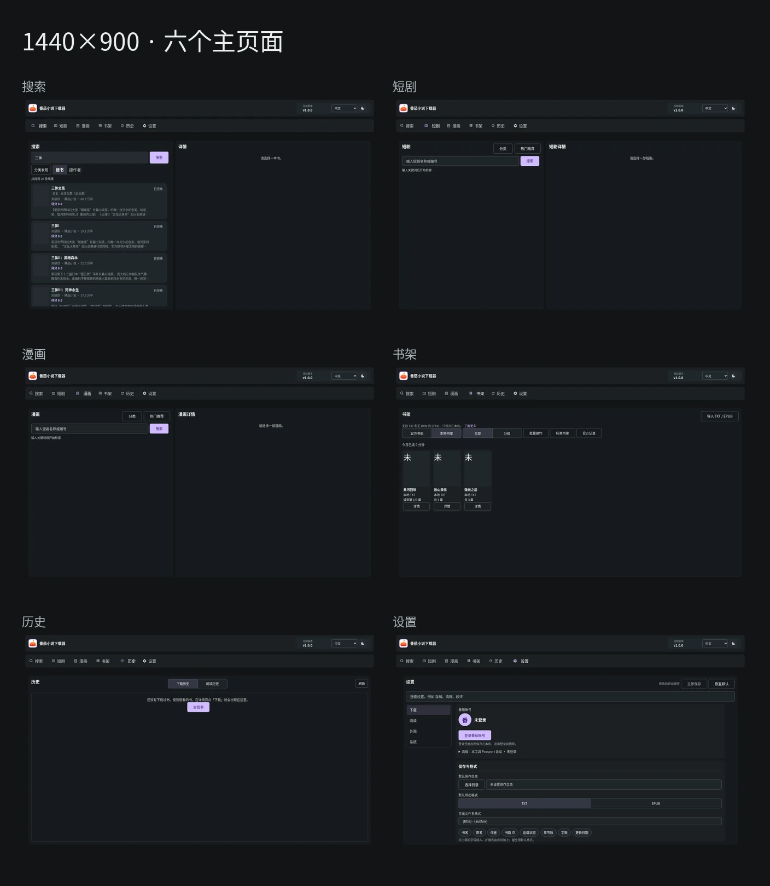
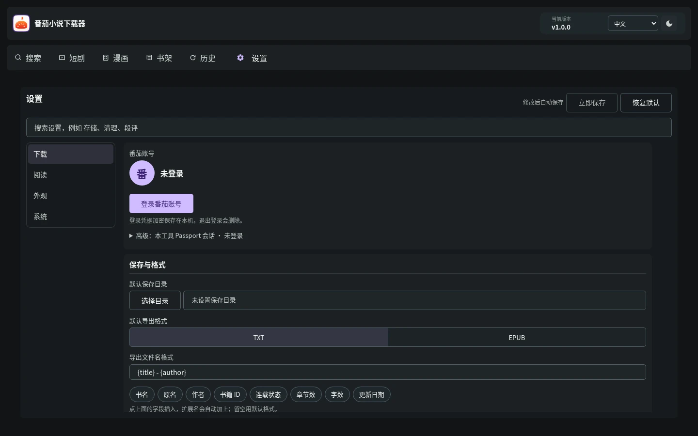
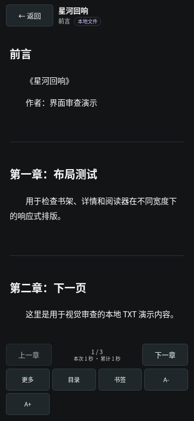

# 番茄小说下载器

**面向小说阅读的跨平台客户端：搜索、下载、离线阅读，也支持漫画与短剧。**

Windows · macOS · Linux · Android · iOS

[下载最新版](https://github.com/POf-L/Fanqie-novel-Downloader/releases/latest) ·
[界面预览](#界面预览) ·
[安装说明](#下载安装) ·
[反馈问题](https://github.com/POf-L/Fanqie-novel-Downloader/issues/new/choose) ·
[参与贡献](CONTRIBUTING.md)

## 项目简介

番茄小说下载器是一个以小说阅读为核心的跨平台应用。它将番茄小说搜索、详情和在线阅读，与单本下载、TXT / EPUB 导出、离线阅读和本地书籍导入放在同一个客户端；也提供漫画、短剧、书架、阅读历史和听书等页面。桌面端与移动端共用一套界面，布局会随屏幕宽度调整。

小说、漫画和短剧的内容及部分功能依赖上游服务，可能受网络、账号状态、地区或平台接口变化影响；客户端不承诺上游内容始终可用。

## 功能一览

- 搜索小说并查看详情、目录和章节；在线阅读，或下载单本作品并导出 TXT / EPUB。
- 阅读器支持翻页或滚动、简洁控件模式、字号和阅读外观调整；可导入本地 TXT / EPUB 阅读。
- 书架、阅读进度和阅读历史；支持本地备份与恢复，以及可选的 WebDAV 备份。
- 浏览漫画与短剧；相关在线播放、缓存、下载和账号功能依具体内容及平台而异。
- 听书选项包括有声书、AI 音色或系统朗读；可用能力会因作品、账号和设备而异。
- 中文、English、Русский；提供浅色、深色等界面外观选项。

> **下载范围说明：**当前版本不支持一次批量下载多本（部）作品。可以在单本作品内选择多章；短剧可对同一部剧的多集操作。请避免高频请求，并遵守平台规则。

## 界面预览

  
   桌面主要页面总览 · Chromium 演示视口

<table>
<tr>
<td width="50%" align="center"> 设置 · 桌面宽屏</td>
<td width="50%" align="center"> 阅读器 · 手机窄屏，默认紧凑工具栏</td>
</tr>
</table>

> 以上截图对应当前正式发布 [`2026.11.20-1136`](https://github.com/POf-L/Fanqie-novel-Downloader/releases/tag/unsigned-v2026.11.20-1136-r861)（`unsigned-v2026.11.20-1136-r861`）的界面，来自 Chromium 演示构建，不是原生设备拍摄；画面中的书名、正文、搜索结果及账号状态均为演示/本地测试数据，不代表真实用户账号。桌面总览为多个页面拼图，窄屏阅读图展示本地 TXT 演示内容。

## 下载安装

从 **[Releases 最新版](https://github.com/POf-L/Fanqie-novel-Downloader/releases/latest)** 下载与你的设备架构相符的文件。每个版本提供的资产以 Release 页面为准。

| 平台 | 文件类型 | 说明 |
| --- | --- | --- |
| Windows | `windows-x64-setup.exe` / `windows-x64-portable.exe`；ARM 设备选 `windows-arm64-*` | 安装版或便携版；未提供 Authenticode 签名，Windows 可能显示安全提示。 |
| macOS | `darwin-aarch64.dmg` 或 `darwin-x64.dmg` | Apple Silicon 选 aarch64，Intel 选 x64；未做 Developer ID 签名和公证，首次打开需在系统“隐私与安全性”中允许。 |
| Linux | `.deb`；x64 另有 `.AppImage` | 按架构选择；AppImage 可能需要先执行 `chmod +x 文件名.AppImage`。 |
| Android | `android-arm64-v8a.apk`、`android-armeabi-v7a.apk`、`android-x86_64.apk` 或 `android-universal.apk` | Android 8.0 / API 26 起。更新安装须使用同一签名；若签名不同，需先卸载旧版。 |
| iOS | `.ipa` | 当前为无 Apple 签名 IPA，需通过 AltStore、Sideloadly 等方式侧载；不是 App Store 安装包。 |

Windows 与 macOS 版本没有厂商/系统级代码签名。请只从本项目 GitHub Releases 下载，并可用 Release 中的 `SHA256SUMS-unsigned.txt` 等校验文件核对；不要在不了解风险时绕过系统安全提示。

## 常见问题

为什么 Windows 或 macOS 会显示安全提示？

当前桌面发布包未使用 Windows Authenticode 签名，也未使用 Apple Developer ID 签名和公证，因此系统可能提示未知发布者或无法验证开发者。确认下载自本项目 Release 后，再自行决定是否继续；不要关闭系统的整体安全防护。

Android 新版安装时提示签名冲突怎么办？

Android 只允许同一签名证书的应用直接覆盖升级。如果现有安装包由不同签名构建，需先卸载再安装；卸载前请先备份需要保留的本地数据。

下载保存在哪里？

在应用设置中查看或选择保存目录。桌面与移动系统的文件权限和可访问位置不同；具体路径以你的设备和当前设置为准。

换设备时，已下载的书也会自动过去吗？

备份功能可迁移受支持的应用数据，但已下载的 TXT / EPUB 文件需单独复制到新设备。备份内容与选项以当前版本的“备份与恢复”页面为准。

## 反馈与交流

遇到问题或有改进建议，请到 [Issues](https://github.com/POf-L/Fanqie-novel-Downloader/issues/new/choose) 选择合适的模板。错误反馈请附诊断日志，并提供版本号、操作系统和复现步骤；提交前请移除账号、Cookie 等个人信息。发布记录见 [Releases](https://github.com/POf-L/Fanqie-novel-Downloader/releases)。安全问题请使用 [GitHub 私密安全报告](https://github.com/POf-L/Fanqie-novel-Downloader/security/advisories/new)，不要公开发布。

欢迎查看[贡献指南](CONTRIBUTING.md)和[产品边界](CONTRIBUTING.md#产品边界)。

## 免责声明

本项目免费提供，供个人学习和阅读使用。请支持正版，并遵守相关平台规则及当地法律法规。请勿用于高频批量请求、传播或侵犯作者与平台权益的用途。上游服务、接口和内容可能变化；使用者应自行判断并承担使用本工具的责任。
