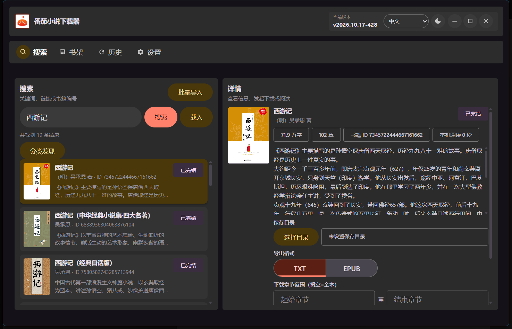
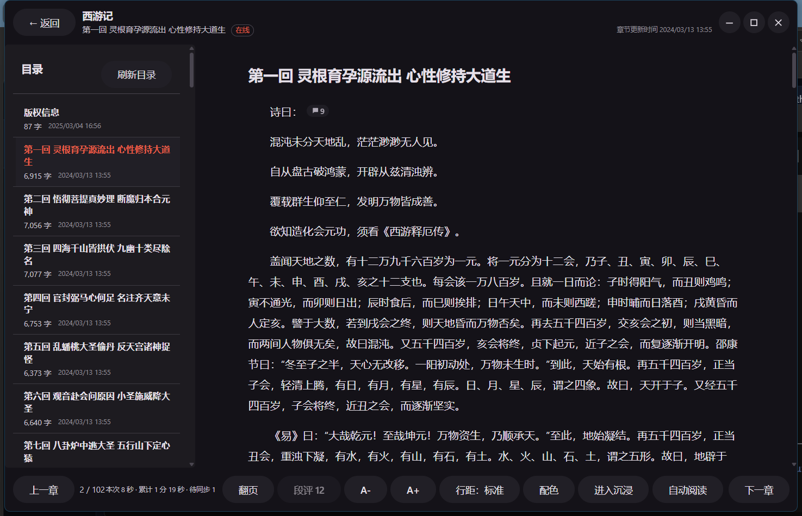
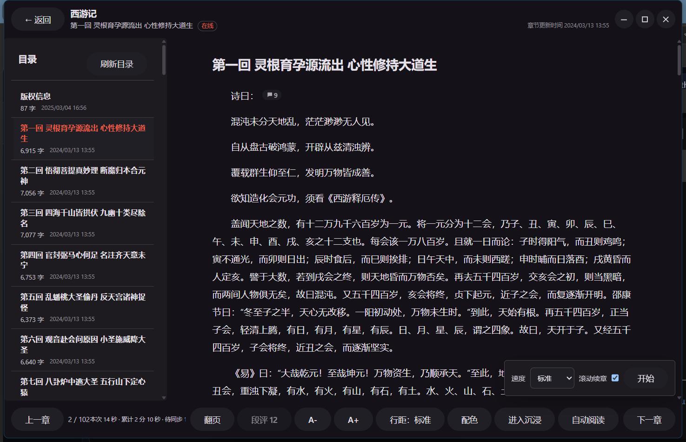
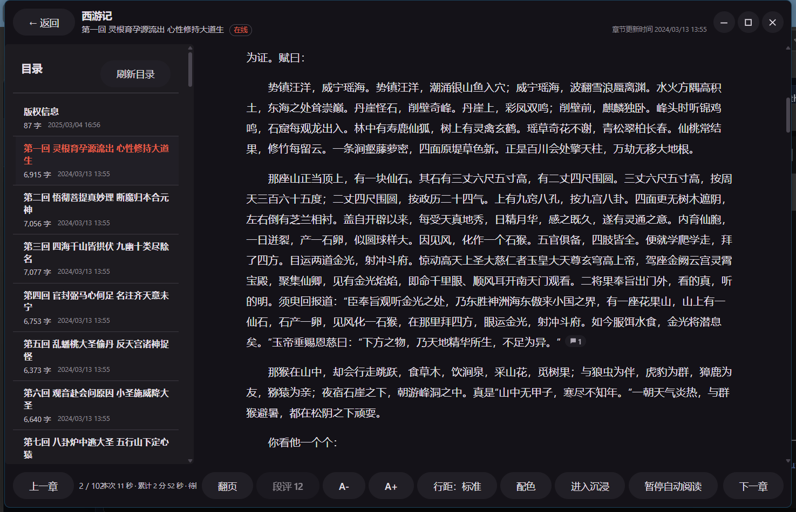

# 番茄小说下载器

基于 **Rust + Tauri v2** 的跨平台番茄小说下载与阅读工具：搜索、书籍详情、在线阅读、
离线书库、本地 TXT / EPUB 导入和段评查看，并可导出 TXT / EPUB。桌面端与移动端共用
同一套界面与后端。

[](https://github.com/POf-L/Fanqie-novel-Downloader/releases/latest)
[](https://github.com/POf-L/Fanqie-novel-Downloader/actions/workflows/ci.yml)

- [下载最新版本](https://github.com/POf-L/Fanqie-novel-Downloader/releases/latest)
- [查看全部版本](https://github.com/POf-L/Fanqie-novel-Downloader/releases)
- [提交问题或建议](https://github.com/POf-L/Fanqie-novel-Downloader/issues/new/choose)

## 界面预览

以下截图来自 Windows x64 客户端，使用隔离的应用数据目录生成，不包含个人书架、账号、
Cookie 或本地路径信息。



在搜索页用关键词、番茄小说链接或书籍 ID 查找，左侧列出结果；选中书籍后，右侧详情页显示
封面、作者、字数、章节数、书籍 ID 和简介，并可设置保存目录、导出格式与下载章节范围。



阅读器提供章节目录、上一章 / 下一章、字号与行距调整、阅读主题与背景、沉浸模式，以及
翻页 / 滚动两种阅读方式。





自动阅读只需选择速度和是否滚动续章，点击“开始”后面板立即收起；运行时底栏入口显示
启用状态，点击入口即可暂停。

## 主要功能

### 搜索与书籍信息

- 通过关键词、番茄小说链接或书籍 ID 搜索和直接载入书籍；支持粘贴分享文本批量导入
- 查看封面、作者、分类、字数、连载状态、最近更新时间和简介
- 章节目录显示分卷、章节字数和章节更新时间；唯一且无正文的默认卷会自动隐藏
- 书籍改名后，用改名前的旧名称搜索仍能命中

### 在线阅读与离线书库

- 应用内在线阅读，支持目录跳转、章内位置恢复和阅读进度记录
- 独立离线书库：可缓存整本章节、查看缓存进度、暂停后继续、更新或删除单本离线正文
- 在线与离线结合：阅读时会检查最新目录，发现新章可直接阅读并按需补入离线缓存，
  不会在后台自动下载整本书
- 联网失败、超时或目录不完整时保留已有正文与进度，不误报“已是最新”，也不删除离线正文

### 本地导入阅读（TXT / EPUB）

- 在“书架”点击“导入 TXT / EPUB”即可导入本机文件：TXT 支持 UTF-8、GB18030 / GBK 和
  带 BOM 的 UTF-16，EPUB 支持无 DRM 的 EPUB 2 / 3 并保留插图与图注
- 单本原文件最大 32 MiB；EPUB 解压总量最多 128 MiB，单篇 XHTML 最多 4 MiB，单张图片
  最多 8 MiB
- 只显示提取后的正文，不执行脚本、不加载外部资源，也不修改原文件
- 导入内容仅保存在本机，不会上传，也不会把文件内容发送给番茄接口；重复导入相同内容
  不会重复创建书籍
- 本地书籍不提供官方书架、联网更新和段评功能

### 导出

- 导出 TXT / EPUB，支持指定章节范围
- 导出文件名格式可用 `{title}`、`{author}`、`{book_id}`、`{status}`、`{chapter_count}`、
  `{word_count}`、`{last_update}` 组合，例如 `{title}-{author}-{book_id}`；留空使用默认的
  “书名 - 作者”
- EPUB 可开关卷目录分组、插图内嵌和封面内嵌，并可为所有 EPUB 指定统一的行距与段间距
- 可选“导出时同时保存封面图片”，也可在详情页单独另存封面
- 可选“导出时附带热门段评”（默认关闭），并可设置段评最低点赞数

### 下载任务与历史记录

- 单本下载、批量下载和任务清单导入；清单去重后每次最多 10,000 本，按顺序逐本下载
- 任务支持暂停、继续、取消和失败 / 缺失章节重试；批量失败可只重试未完成的书
- 进度可切换百分比、章节（已获取 / 已缓存）和分组（本轮完成 x/y 组）三种显示方式
- 队列、暂停和取消状态保存在本机；退出程序后不继续后台下载，再次启动可从“历史”继续
- 历史页是唯一的下载记录页面：筛选、检查书籍更新、重下、删除记录、删除文档和清空记录
- “检查书籍更新”对比已下载书籍的最新目录，可只检查选中记录，并支持重下全部更新、重下
  选中或单条重新下载；正文全部成功后才会替换旧文件

### 阅读器

- 章节目录、上一章 / 下一章；长目录展开或收起时保持当前位置，不会跳回当前章节
- 翻页与滚动两种阅读方式：翻页按屏翻动，到边界才跨章
- 字号调节、行距切换和图片放大预览
- 阅读主题与背景：跟随应用、羊皮纸、深夜、素白、豆沙绿、雾蓝、淡粉或自定义；自定义
  支持文字与背景颜色，并可叠加一张本地 PNG / JPEG / WebP 背景图片
- 沉浸阅读：可在设置中改为进入阅读器即隐藏工具栏，点击正文中央临时显示或隐藏
- 简洁阅读模式：只保留目录、上下章与字号等基础操作，隐藏其余阅读工具
- 自动阅读：慢、标准、快、极快四档速度，可选滚动到底部自动接续下一章；按住正文暂停，
  松开 3 秒后自动恢复
- 记录本机有效阅读时长，并按段落位置恢复章内阅读进度

### 段评

- 阅读器底部“段评”查看本章概览（各段的上游统计数量），可切换热门 / 最新、加载更多、
  查看回复，并通过“定位原文”返回对应段落
- 段评和回复自带的图片会直接显示在评论下方（图片来自官方接口返回的公开图片地址，无需登录）
- 无需登录即可查看；当前仅提供查看，不提供发表、点赞或删除评论
- 可在设置中关闭正文气泡，或彻底关闭段评功能

### 书架

- 本地书架与官方书架分别管理；点击封面直接阅读，在详情页管理离线内容与下载
- 官方书架支持全部 / 分组 / 出版分类和刷新
- 批量操作：全选、加入本地书架、缓存离线、批量下载、导出 / 导入书籍 ID、清理本书、
  移动分组和移出书架
- 紧凑书架模式可在同一屏显示更多书籍

### 外观与个性化

- 明暗模式：跟随系统、浅色、深色或经典；顶部按钮可临时切换
- 强调配色：默认、草野、柠檬、黑白、暮紫、樱粉
- 界面密度：紧凑、标准、宽松
- 选项大小：小、中、大，同时影响阅读页、书架与历史页的操作按钮
- 界面语言：中文、English、Русский
- 启动页面可选搜索、本地书架或官方书架

### 隐私与系统

- 应用伪装：开启后应用显示为计算器，输入解锁密码后按 `=` 恢复；可自定义伪装标题和
  4–12 位数字密码；Android 还可伪装桌面图标（计算器、记事、天气）与最近任务卡片
- Android：沉浸式全屏、沉浸式保留底部导航栏，以及“始终隐藏状态栏”
- 安全诊断日志：默认关闭，可开启、打开日志目录或导出为文本文件

### 更新

- 桌面版检查到新版本后可在应用内下载并安装更新包，按发行形态与架构精确匹配
- Android、iOS 提示新版本后跳转下载页手动安装，同一版本只提示一次
- 顶部版本卡片始终保留为手动检查与下载入口

## 下载使用

普通用户请优先从[最新版本](https://github.com/POf-L/Fanqie-novel-Downloader/releases/latest)
下载。每个 Release 的说明会列出实际附件、签名状态、安装限制和校验文件；没有发布的
平台或架构不要使用其他安装包代替。

| 平台 | 支持架构 | 普通用户选择 | 当前发布方式 |
| --- | --- | --- | --- |
| Windows | x64、ARM64 | 安装版选 `windows-*-setup.exe`；免安装使用选 `windows-*-portable.exe` | 两种形态都支持自动更新和手动下载，且不会互相转换 |
| Linux | x64、ARM64 | Debian / Ubuntu 选 `.deb`，其他发行版可选 `.AppImage` | DEB 与 AppImage 只更新到相同包类型 |
| macOS | Intel、Apple Silicon | 对应架构的 DMG 或 APP ZIP | APP 形态只接收同架构 APP 更新；无 Apple 签名时仍会受 Gatekeeper 限制 |
| Android | arm64-v8a、armeabi-v7a、x86_64、universal | 优先 `arm64-v8a.apk`，不确定架构时选 `universal.apk` | 应用内提示新版本，需手动安装；Android 7.0 / API 24 起 |
| iOS | ARM64 | 无签名 IPA | 应用内提示新版本；需要自行侧载；不上架 App Store |

### Windows

大多数电脑选择 `x64`，Windows on ARM 设备选择 `ARM64`。安装版会运行 NSIS 安装器并保留
安装目录和卸载信息；便携版会在退出后原位覆盖当前程序并重启，不会创建安装目录、快捷
方式或卸载项。

当前安装包尚未配置 Windows Authenticode 发行商证书，因此 Windows 可能提示“未知发布者”
或触发 SmartScreen。安装或手动覆盖前请核对 Release 中的 SHA-256 校验清单。

旧便携版无法安全区分安装包与便携包，需要从最新 Release 手动下载一次同架构
`windows-*-portable.exe`，关闭程序后覆盖旧文件；完成这次迁移后即可使用便携版原位自动
更新。不要用 `setup.exe` 覆盖便携版，也不要把便携版附件当作安装器运行。

### Linux

桌面壳依赖 **WebKitGTK 4.1**。AppImage 首次运行前需要授予执行权限：

```bash
chmod +x FanqieNovelDownloader-*.AppImage
```

具体是否同时提供 DEB 与 AppImage，以对应 Release 的实际附件为准。应用内更新只会选择与
当前运行包类型及架构完全一致的条目；缺少对应条目时会转为手动下载。

### macOS

Apple Silicon 选择 `arm64`，Intel 选择 `x64`。当前 macOS 包未经过 Developer ID 签名和
公证，首次启动会被 Gatekeeper 拦截：先核对 SHA-256，再前往“系统设置 → 隐私与安全性”
选择“仍要打开”。只有 Release 说明明确要求时，才对该应用单独移除隔离属性；不需要全局
关闭 Gatekeeper。

### Android

APK 可以直接安装；AAB 是应用商店上传产物，不能像 APK 一样直接打开安装。安装 APK 时
需要允许当前文件管理器或浏览器安装未知来源应用，并且只有新旧版本使用同一签名证书时
才能覆盖升级。应用通过系统目录选择器保存 TXT / EPUB，并可交给已安装的阅读器打开，或
回退到系统分享 / 保存面板。

### iOS

提供的是无 Apple 签名 IPA，需要使用 AltStore、Sideloadly 或其他受信任方式自行侧载。
安装后可能需要在“设置 → 通用 → VPN 与设备管理”中信任对应证书。它不属于 App Store 或
TestFlight 正式发布。

## 快速上手

1. 安装与系统架构匹配的版本。
2. 在“设置”中选择默认保存目录和 TXT / EPUB 格式，修改后会自动保存，无需手动点击保存。
3. 在“搜索”输入关键词，或直接粘贴番茄小说链接、书籍 ID；需要整份书单时点击“批量导入”。
4. 在详情页选择在线阅读、缓存离线正文、加入书架、全本下载或章节范围下载；需要释放空间
   时，可在详情页或任一书架卡片点击“清理本书”。
5. 在“历史”查看下载进度或打开已导出的文件；需要批量释放导出文件空间时，勾选记录后点击
   “删除选中文档”。“清空记录”只删除历史条目，不删除磁盘文件。
6. 阅读时可从底栏打开“自动阅读”，选择速度后点击“开始”；自动阅读会连续下滑并在章节
   末尾接续下一章。阅读中按住正文会暂停，松开手指或鼠标后等待 3 秒自动继续；点击底栏
   入口则永久暂停。
7. 只想阅读本机文件时，在“书架”点击“导入 TXT / EPUB”选择文件。

遇到网络超时或上游接口暂时不可用时，请等待一段时间再重试，避免短时间内连续发起大量
请求。诊断日志默认关闭；需要排查时可在“设置 → 系统”临时开启，日志会对接口参数、签名、
Cookie 和书籍标识进行脱敏。

## 数据与隐私

- 阅读进度、阅读时长、本地书架、官方书架缓存和离线正文保存在你的设备上；官方账号返回
  的累计阅读时间与应用记录的本机阅读时长是两套独立数据，项目不会把本机时长当作官方字段
  写入
- 退出官方账号只删除本机凭据和官方书架缓存，不会删除阅读进度、阅读时长、书架和离线正文
- 离线正文保存在应用数据目录下的独立书库（`offline-books`）中；“删除离线正文”只删除该书
  的离线书库，其余数据保留
- 应用的网络访问只用于番茄接口与版本更新；本地导入的文件内容、标题、阅读进度和时长不会
  发送给这些接口
- 诊断日志默认关闭，需要时可在“设置 → 系统”开启、打开日志目录或导出；日志字段统一经过脱敏，
  URL、主机名和长标识符只写哈希或占位

## 常见问题

**大书单批量导入后无法开始下载**

超过 500 本时后台会拒绝、界面却不显示错误的问题已修复。当前版本每次支持去重后最多
10,000 本，一个任务按清单顺序逐本下载，不会同时启动数千本；退出后可在“历史”继续未完成
任务。解析结果会显示数量与上限；超限、目录无效或任务冲突等错误直接显示在导入弹窗中，
输入不会丢失。若连接中断、未确认创建成功，请先检查任务列表，再决定是否重试。

**设置需要手动保存吗**

不需要。设置页的开关、选项和目录选择会立即自动保存；文件名格式在停止输入 0.5 秒或
离开输入框后保存。顶部会显示等待保存、保存中、已保存或失败状态，退出前请确认已保存。
无效的文件名格式不会提交，需先修正；保存失败会保留当前输入，可点“重试保存”。本机
WebView / 浏览器存储可用时，快速关闭或刷新后还会恢复待保存草稿并再次尝试保存。

**检查到书籍更新后会自动重新下载吗**

不会。默认在启动后及运行期间每小时检查已下载在线书籍的最新目录，也可以在“历史”手动
“检查书籍更新”。确认后由你选择“重下全部更新”“重下选中”或单条“重新下载”；重下会沿用
原来的文件名、目录、格式和章节范围，正文全部成功后才替换旧文件。本地导入的书籍不参与
联网检查。

**本地导入的 TXT / EPUB 会上传吗**

不会。导入只读取你选择的文件并保存到本机离线书库，不修改原文件，也不会把文件内容、
标题、阅读进度或阅读时长发送给任何接口。EPUB 只提取正文与插图，不执行书内脚本。

**为什么附带导出的段评不是全部评论**

导出的段评是限定选摘，不是全量：每章按正文顺序最多收录前 30 个有评段落，每段只取热门
前 5 条，包含昵称、评论内容和点赞数，不含回复和头像。需要浏览全部评论时请在阅读器内查看。
段评自带的图片会一并收录（issue #394）：阅读器内直接显示；EPUB 导出时在开启“保留章节
插图”的前提下随书内嵌；TXT 导出时在段评下方写出图片地址（纯文本无法内嵌二进制文件）。

**翻页模式和滚动模式有什么区别**

滚动模式保持连续下滑，适合逐段阅读；翻页模式按一屏翻动，只有到页面边界时才跨章，适合
整屏阅读。两种模式都可以配合自动阅读使用。

**macOS 提示应用已损坏**

这不表示下载文件损坏，而是 Gatekeeper 对带隔离属性且缺少 Apple 公证的应用给出的提示。
请先确认架构并核对校验和，然后前往“系统设置 → 隐私与安全性”选择“仍要打开”。不需要、
也不应全局关闭 Gatekeeper。

**Linux 无法启动**

先确认系统已安装 WebKitGTK 4.1 运行库；AppImage 还需要执行权限。不同发行版的软件包
名称不同，请使用发行版自己的包管理器查询。

**Android 找不到下载文件**

请在应用内重新选择共享目录并保留系统授予的访问权限。导出完成后可从历史记录打开文件，
或在系统文件管理器中进入所选目录查看。

**“清除临时缓存”和“删除离线正文”有什么区别**

临时缓存只服务于当前运行中的详情、目录和章节访问，最多保留约 10 分钟，关闭应用也会
消失；它不会删除磁盘上的离线正文。删除离线正文会释放该书离线书库占用的空间，同时使
相关临时缓存失效，但不会移除本地 / 官方书架记录、阅读进度、阅读时长或已导出的
TXT / EPUB。正在缓存该书时，请先取消对应离线任务，再删除离线正文。

**“删除选中文档”和“清空记录”有什么区别**

“删除选中文档”会删除勾选记录对应的 TXT / EPUB 文件，并在成功后移除对应历史条目；文件
已经不存在时也会清理失效记录。出于安全考虑，目录、符号链接和非 TXT / EPUB 文件不会被
删除。“清空记录”只清空应用内历史，不触碰本地或 Android 系统目录中的导出文件。两项操作
都不会影响书架、阅读进度、阅读时长或离线正文。

**便携版更新后为什么不能变成安装版**

新版本会先识别当前 Windows 发行形态：正常安装目录中的 NSIS 版本只选择安装版附件，原始
便携程序或被复制到其他目录的兼容形态只选择便携版附件。找不到精确附件或签名时只提供
Release 页面。旧便携版需要按上面的 Windows 说明手动覆盖一次修复版。

**搜索或下载持续超时**

先确认正在使用最新版本，并排除代理、私有 DNS、防火墙或网络波动。仍可复现时，提交错误
反馈并附上脱敏后的完整错误文本、平台、版本和复现步骤。

## 问题反馈

请从 [Issue 提交入口](https://github.com/POf-L/Fanqie-novel-Downloader/issues/new/choose)
选择“错误反馈”“功能建议”或“使用求助”。仓库不接受空白 Issue，结构化表单会收集版本、
平台、架构、复现步骤和必要的诊断信息。

提交 Issue 前需要先公开 Star 当前项目。Issue 创建或重新打开后会由 Actions 自动核验；
未通过时会先收到礼貌提醒，Issue 在 10 分钟宽限期内保持开放。宽限期内核验通过后，提醒
会自动删除且 Issue 继续开放；超过 10 分钟仍未公开 Star 才会以 `not planned` 关闭。

公开内容中请删除 token、签名、Cookie、设备标识和其他个人数据。安全漏洞请使用
[私密漏洞报告](https://github.com/POf-L/Fanqie-novel-Downloader/security/advisories/new)，
不要创建公开 Issue。

## 支持与赞助

如果这个项目对你有帮助，也欢迎自愿通过下面的合作服务支持项目维护。

> 这是推广邀请链接。合作方目前标注通过该链接注册可获 **1 美元**，项目方也可能获得
> 推广收益；是否使用该链接不影响软件功能、Issue 受理或问题处理。

注册链接：<https://999554.xyz/register?aff=Xf2p>

赞助与推广合作请通过[仓库所有者主页](https://github.com/POf-L)公开的联系方式沟通，
不要提交为产品 Issue。

## 使用声明

请合理使用本工具，并遵守相关平台规则与当地法律法规。项目不保证上游接口永久可用，
也不建议将自动化下载用于高频、批量滥用或侵犯他人权益的场景。
